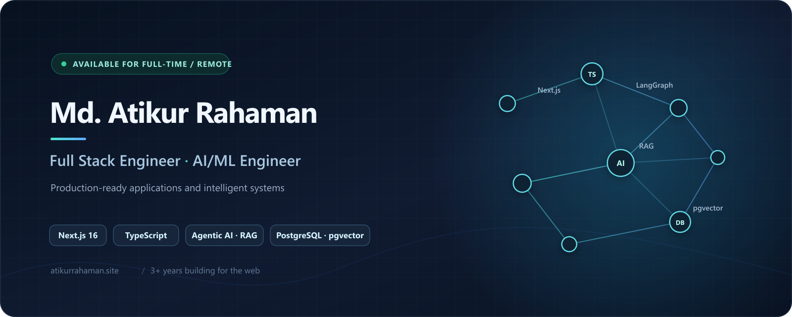

  

<h1 align="center">Hi, I'm Md. Atikur Rahaman 👋</h1>

  <strong>Full Stack Engineer · AI/ML Engineer</strong> 
  Building production-ready web applications and intelligent systems · 3+ years of experience

  <a href="https://www.atikurrahaman.site/">Portfolio</a> ·
  <a href="https://www.linkedin.com/in/atikur-rahaman-203cba/">LinkedIn</a>

**Email:** atikurrahaman0305@gmail.com

I'm a Computer Science and Engineering student at **United International University**. I build full-stack products with **Next.js, TypeScript, Node.js, and PostgreSQL**, and work on **Agentic AI, RAG, and machine learning**. I'm currently available for full-time and remote roles.

## Skills & Technologies

### Languages

  

### Frontend

  
  

### Backend & Data

  
  

### AI & Machine Learning

  
  
  
  
  
  

**AI engineering:** Agentic AI · RAG · Multi-agent systems · LLM applications · PostgreSQL/pgvector

### Tools & DevOps

  

### Other Backend Tools

  
  

## GitHub Activity

  
  

  

## Featured Projects

| Project | What it does | Stack |
| --- | --- | --- |
| [ScholarFlow](https://github.com/Atik203/Scholar-Flow) · [Live](https://scholar-flow-ai.vercel.app/) | Research collaboration SaaS with semantic paper search, shared libraries, and PDF annotations. | Next.js, Express, TypeScript, PostgreSQL, pgvector |
| [GradPlanner](https://github.com/Atik203/GradPlanner) · [Live](https://gradplanner-bd.vercel.app/) | Helps STEM applicants compare graduate programs, funding, and application deadlines. | Next.js, Express, TypeScript, Prisma, PostgreSQL |
| [HaluRISC](https://github.com/Atik203/HaluRISC) · [Live](https://halurisc.vercel.app/) | Explainable ML framework for analyzing and calibrating hallucination risk in LLM outputs. | Python, FastAPI, PyTorch, scikit-learn |
| [MotoServe](https://github.com/Atik203/MotoServe) · [Live](https://motoserve-web.vercel.app/) | Workshop booking and dispatch platform with automated status workflows and payments. | Next.js, FastAPI, TypeScript, PostgreSQL |

  <a href="https://www.atikurrahaman.site/">Explore more projects on my portfolio →</a>

